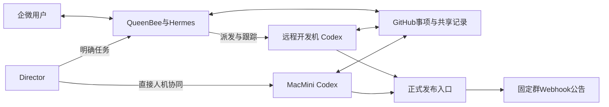

# 02.角色与工具：每个参与者负责什么

> 文档状态：Review
>
> 责任角色：Director
>
> 本文负责：解释负责人、使用者、协调方、开发工具和消息通道的责任及交接

## 1.先看责任，再看工具名称

HiveFlow把一次协作分成几种责任：有人提出问题，有人确认方向，有人调查协调，有人实施，有工具保存记录和传递消息。

这些责任由使用者、Director、Hermes、两处Codex和GitHub承担。QueenBee是企微交互身份，固定群消息推送是主动通知身份。

|参与者|职责|
|---|---|
|使用者|反馈实际现象、期望和必要补充|
|Director|决定方向、范围与交付终点，直接协同MacMini Codex|
|Hermes|接收企微消息、调查与登记、沟通采纳、派发及跟踪远程开发机任务|
|远程开发机 Codex|在获准范围执行研发和交付|
|MacMini Codex|由Director直接人机协同开发，不接受Hermes指导或调度|
|GitHub|保存Issue、PR、检查及共享执行占用和接棒事实|
|固定群Webhook|在获准原群发送正式事项回执；发布脚本向单独核验的发布群发送公告|

两处研发都可选择PR待审或完整交付。Hermes不向MacMini派单；跨机器继续由本人明确要求并核验原结果。Dots和Slack已退出当前入口。

## 2.使用者负责提供真实场景

用户不需要先学会内部分类，也不需要知道缺陷位于哪个模块。说清“正在做什么、哪里不符合预期、希望怎样”就有价值。

如果用户已经知道操作步骤、发生时间和影响范围，可以一起提供；不知道原因时不必猜测。协调方应利用现有资料继续调查，每次只补问一两项影响判断的关键缺口。

普通用户在群里说“可以改”，仍然只是群上下文中的表达。已获准群或本人单聊中的当前本人消息，可按[认证例外](../../06-自动化/HFL-003-协作流程与授权.md#企微本人认证例外)核验真实企微事件、固定本人身份及具体范围后承接，不必回Hermes重复批准；显示名、转述和旧批准不能替代认证。

## 3.Director负责方向和边界

Director是对当前工作的决定和结果负责的人，不要求对应某个固定组织岗位。

面对一个新事项，负责人可能作出三种不同决定：值得继续做、暂缓、或者不采纳。决定实施时，还要明确目标、范围、交付位置和验收。值得做与可以实施分别记录，能避免把一句赞同解释成不限范围的执行许可。

负责人也可以直接给出完整的具体任务。例如，明确修改范围、检查、PR、合并、开发环境部署和验收后，实施者可以连续推进这些步骤。已有授权仍有效时，不需要在每个工具调用前重新问一次。

## 4.Hermes负责理解和协调

Hermes先理解反馈，在已有权限内查证相关代码、规范与必要环境事实。它需要把事实、推断、未知分开，把产品取舍整理成负责人容易判断的单项问题。

群反馈采纳评审和Hermes协调任务的私有决定使用已认证本人企微单聊。普通咨询或必要澄清可以留在原群或已允许的本人单聊；已认证本人当前明确请求按上述窄例外承接，其余群反馈不产生研发授权。私有结果仍留在获准本人通道，不因请求来自群而公开。

Hermes不会因为自己能读某个私有记录，就把它公开到群。它也不能替另一个Codex会话制造许可，或者因为看不到对方的私有聊天就认定对方没有做过工作。

## 5.Codex负责实际实施与验证

在蜂巢当前采用的本人直接手动路径中，负责人在MacMini上自己的可信Codex会话发起任务。该执行会话核验本人、工具权限、唯一事项和完整范围后，推进已经允许的步骤，无须迁回Hermes重新批准。

远程开发机可由Hermes交接获准任务，Codex自己核验来源、范围、真实运行身份及工具能力。自动研发统一迁向远程开发机，由Hermes原生调度安排Codex，MacMini保留本人直接协同开发。两种交付终点共用一个远程调度入口；实际配置、长任务跟踪、停止和连续运行仍须分别验收。

实施者先核对当前仓库、分支、已有改动和相关任务，再修改并运行合适的检查。遇到必须独立评审的候选，要有真实的独立评审，作者自查不能冒充。

“已修改”“已检查”“PR待审”“已合并”“已部署”“已验收”是不同事实。Codex交付时逐项说明，协调方和用户才能理解真正完成到哪里。

## 6.GitHub和私有通知记录各保存什么

GitHub保存经过脱敏并适合目标仓库受众的事项和交付事实。Issue编号帮助定位事项，PR和提交帮助定位代码，检查与验收证据帮助判断结果。

Hermes适配器提供真实入站事件；私有记录保存来源关联、本人决定依据及获准路由。Webhook只负责向固定群提交消息，没有服务端去重或状态查询。执行者在发送前持久记录稳定编号、受众和请求摘要，未知先核实，不换机器重发。这些记录不能代替实施授权或业务验收。

公开给群的反馈与私有的传输证据分别保留。仓库里不放群标识、私人聊天、凭据或完整路由配置。

## 7.为什么要分开决定通道与反馈通道

群里适合讨论现象、用法和可公开进展；负责人本人通道适合核验取舍、范围和私有结果。分开以后，用户仍可持续补充信息，实施者也能准确知道哪个决定适用于哪个任务。

同一个人出现在不同群、多个线程或开发会话中，不表示这些地方可以共享上下文和许可。每次读取和披露都要对应当前事项与受众。

这也解释了一个常见情况：用户已经在群里反馈，负责人又在Codex中直接处理。此时应核对GitHub与现有交付证据，复用完成部分，而不是要求把已经做完的研发重新交给Hermes。

## 8.通过Issue交接到执行宿主时带走什么

Issue登记后，由本人明确选择的远程开发机或MacMini执行任务。Hermes只协调远程开发机，不接管MacMini。接手者先核验共享执行占用、当前工作树和已有PR；没有占用不代表没有普通人机协同工作。新采纳选单仍需第10章的可信基线和逐单记录，正式回执按第8章单独处理。

交接不需要搬运全部聊天。对接续工作有用的材料通常是：准确事项、目标与范围、当前版本、已发生的动作、检查结果、已知剩余项和停止条件。

私人批准正文、身份资料和原始日志留在受控位置。接手者读取获准的必要证据，核验原任务和实际结果；收到一份摘要本身不等于继承对方的工具权限。

如果工具缺少必要能力，应说明具体缺口。普通评论、标签或“已经有人处理”的文字都不是全局锁；不能用约定措辞冒充平台提供了强制互斥。

## 本章依据

- [HFL-003：角色与本人入口](../../06-自动化/HFL-003-协作流程与授权.md)
- [HFL-008：工具职责与实际边界](../../06-自动化/HFL-008-工具接入与使用边界.md)
- [HFL-017：安全与隐私规则](../../06-自动化/HFL-017-安全与隐私规则.md)

[返回目录](README.md)｜[上一篇：认识HiveFlow：把反馈、决定和交付连起来](01-认识HiveFlow：把反馈、决定和交付连起来.md)｜[下一篇：流程总览：一条反馈怎样走到交付](03-流程总览：一条反馈怎样走到交付.md)
