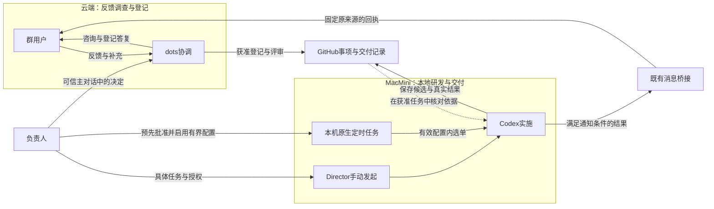

# 02.角色与工具：每个参与者负责什么

> 文档状态：Review
>
> 责任角色：Director
>
> 本文负责：解释负责人、使用者、协调方、开发工具和消息桥接的责任及交接

## 1.先看责任，再看工具名称

HiveFlow把一次协作分成几种责任：有人提出问题，有人确认方向，有人调查协调，有人实施，有工具保存记录和传递消息。

这些责任在蜂巢当前分别由使用者、Director、dots、Codex、GitHub和独立消息桥接承担。其他项目可以使用不同工具，但需要重新验证对应能力，不能因为名称相似就沿用蜂巢的接入结论。

|参与者|主要输入|主要产出|
|---|---|---|
|使用者|实际操作、现象与期望|可以继续调查的反馈和补充信息|
|负责人Director|事实、候选方案和风险|采纳决定、具体任务范围及必要取舍|
|协调方dots|授权内可见的反馈与项目资料|调查结论、可读事项、明确问询和允许公开的结果|
|开发工具Codex|可信任务、当前仓库与有效授权|代码、检查、提交、PR和获准交付的真实证据|
|GitHub|获准保存的事项与代码事实|Issue、PR、提交及相应检查记录|
|消息桥接|经过准入和来源核验的消息|固定受众的消息传输及发送状态|

表中的工具保存或传递事实，负责人仍对方向和授权负责。

蜂巢当前把反馈与研发放在两个地方：云端dots负责调查和事项入口，Director的MacMini负责本地研发。GitHub Issue是交接点，后续可以手动发起，也可以由本机原生定时任务按有效配置承接。

下面按位置和责任画出关系，箭头说明信息怎样交接，不代表收到消息就能自动开工：

两种启动方式都可以选择PR待审或完整交付，区别见第3章。图中省略了消息平台和传输细节；定时开发尚未启用，新采纳记录的交接条件见第9章和第10章。GitHub中的文字变化本身不会授予执行权。

## 2.使用者负责提供真实场景

用户不需要先学会内部分类，也不需要知道缺陷位于哪个模块。说清“正在做什么、哪里不符合预期、希望怎样”就有价值。

如果用户已经知道操作步骤、发生时间和影响范围，可以一起提供；不知道原因时不必猜测。协调方应利用现有资料继续调查，每次只补问一两项影响判断的关键缺口。

用户在群里说“可以改”，仍然只是群上下文中的表达。研发执行要进入可核验的负责人任务通道，不能由群身份或转述的批准替代。

## 3.Director负责方向和边界

Director是对当前工作的决定和结果负责的人，不要求对应某个固定组织岗位。

面对一个新事项，负责人可能作出三种不同决定：值得继续做、暂缓、或者不采纳。决定实施时，还要明确目标、范围、交付位置和验收。值得做与可以实施分别记录，能避免把一句赞同解释成不限范围的执行许可。

负责人也可以直接给出完整的具体任务。例如，明确修改范围、检查、PR、合并、开发环境部署和验收后，实施者可以连续推进这些步骤。已有授权仍有效时，不需要在每个工具调用前重新问一次。

## 4.dots负责理解和协调

dots先理解反馈，在已有权限内查证相关代码、规范与必要环境事实。它需要把事实、推断、未知分开，把产品取舍整理成负责人容易判断的单项问题。

群反馈采纳评审和dots协调任务的私有决定使用dots原生本人主对话。普通咨询或必要澄清可以留在原群或已允许的本人单聊；不能把这些入口自动扩展成研发审批通道。

dots不会因为自己能读某个私有记录，就把它公开到群。它也不能替另一个Codex会话制造许可，或者因为看不到对方的私有聊天就认定对方没有做过工作。

## 5.Codex负责实际实施与验证

在蜂巢当前采用的本人直接手动路径中，负责人在MacMini上自己的可信Codex会话发起任务。该执行会话核验本人、工具权限、唯一事项和完整范围后，推进已经允许的步骤，无须迁回dots重新批准。

另一条路径是MacMini上的原生定时任务：由本人先批准有界配置并实际启用，再按获准频率选择符合条件的事项。手动与定时改变启动方式，执行位置和两种交付终点相同；这不表示定时开发当前已经启用。

实施者先核对当前仓库、分支、已有改动和相关任务，再修改并运行合适的检查。遇到必须独立评审的候选，要有真实的独立评审，作者自查不能冒充。

“已修改”“已检查”“PR待审”“已合并”“已部署”“已验收”是不同事实。Codex交付时逐项说明，协调方和用户才能理解真正完成到哪里。

## 6.GitHub保存什么，消息桥接保存什么

GitHub保存经过脱敏并适合目标仓库受众的事项和交付事实。Issue编号帮助定位事项，PR和提交帮助定位代码，检查与验收证据帮助判断结果。

消息桥接负责准入、路由、固定来源关联、去重和传输。它能够确认消息是否被受理、平台是否返回确认，但不能判断某个产品问题是否值得做，不能替代实施授权，也不能认定业务验收通过。

公开给群的反馈与私有的传输证据分别保留。仓库里不放群标识、私人聊天、凭据或完整路由配置。

## 7.为什么要分开决定通道与反馈通道

群里适合讨论现象、用法和可公开进展；负责人本人通道适合核验取舍、范围和私有结果。分开以后，用户仍可持续补充信息，实施者也能准确知道哪个决定适用于哪个任务。

同一个人出现在不同群、多个线程或开发会话中，不表示这些地方可以共享上下文和许可。每次读取和披露都要对应当前事项与受众。

这也解释了一个常见情况：用户已经在群里反馈，负责人又在Codex中直接处理。此时应核对GitHub与现有交付证据，复用完成部分，而不是要求把已经做完的研发重新交给dots。

## 8.通过Issue交接到MacMini时带走什么

Issue登记后，研发工作以MacMini的实际任务为准继续。云端dots可以保留源头采纳和允许的群沟通，但本地开发、检查、合并与部署不等待它逐步转述指令。新采纳选单仍需取得第10章规定的受控记录；原来源回执按第8章独立处理。

交接不需要搬运全部聊天。对接续工作有用的材料通常是：准确事项、目标与范围、当前版本、已发生的动作、检查结果、已知剩余项和停止条件。

私人批准正文、身份资料和原始日志留在受控位置。接手者读取获准的必要证据，核验原任务和实际结果；收到一份摘要本身不等于继承对方的工具权限。

如果工具缺少必要能力，应说明具体缺口。普通评论、标签或“已经有人处理”的文字都不是全局锁；不能用约定措辞冒充平台提供了强制互斥。

## 本章依据

- [HFL-003：角色与本人入口](../../06-自动化/HFL-003-协作流程与授权.md)
- [HFL-008：工具职责与实际边界](../../06-自动化/HFL-008-工具接入与使用边界.md)
- [HFL-017：安全与隐私规则](../../06-自动化/HFL-017-安全与隐私规则.md)

[返回目录](README.md)｜[上一篇：认识HiveFlow：把反馈、决定和交付连起来](01-认识HiveFlow：把反馈、决定和交付连起来.md)｜[下一篇：流程总览：一条反馈怎样走到交付](03-流程总览：一条反馈怎样走到交付.md)
