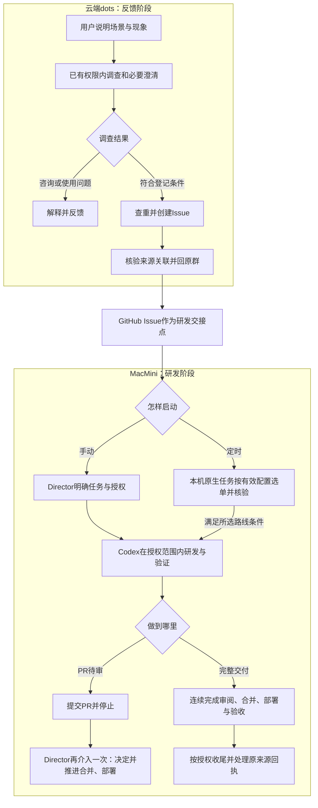

# 03.流程总览：一条反馈怎样走到交付

> 文档状态：Review
>
> 责任角色：Director
>
> 本文负责：用一条合成反馈串起调查、登记、决定、研发、验收与通知

## 1.用一个合成问题走完整条路

本章沿用“导出文件只有第一页”的例子。假设管理员已经接入某个工作群，协调方具有该项目原有的调查和合规新建事项权限。例子中的Issue#42仅为教学编号，不对应真实任务。

完整流程有多个可能的终点。咨询可以解释清楚后结束；调查可以查明是操作方式问题；已登记事项也可能等待决定或实施授权。需要研发时，以Issue为交接点，由Director的MacMini承接后续工作。

在MacMini上，先区分怎样启动，再区分做到哪里。手动发起和原生定时任务，都可以停在PR待审，也都可以选择完整交付。下面突出这两组选择；源头采纳与授权条件在第4、5节说明。

图中定时路径尚未启用。Issue是交接依据，不是执行许可；未授权、暂缓、不采纳或条件不满足时，不会沿箭头自动进入研发。云端dots不承担本地研发的逐步调度。

## 2.先调查，不急着给现象贴结论

协调方先核对操作步骤、预期和实际结果，并检查相关规则与代码。例如，用户是否使用了分页导出入口？产品规则承诺的是当前页还是全部结果？现场实际运行的版本是什么？

静态代码能证明某个分支怎样写，不能直接证明环境已经部署这段代码。附件日志记录的现象，也不能自动证明根因。答复应交代已有依据与剩余未知。

故障调查不以“先建单”或“负责人先采纳”为前提。仍在原只读范围内能做的调查可以继续，不能把一个工单编号当作调查完成。

## 3.证据充分后登记，并保留原来源

如果证据支持蜂巢自身缺陷，而且需要修改代码，协调方先查重，再在已有授权内创建待确认Issue。新需求则根据场景、价值、初步范围和验收整理登记，不能套用故障判断替代需求评估。

创建后独立读取实际结果，确认仓库和编号正确。随后在原请求有效期内及时完成可信来源关联，核验桥接确认；这使后续交付有机会准确回到原反馈者所在的群。

来源关联失败不抹去已经创建的事项，也不阻塞已有权限内的普通登记答复，但不能承诺长期回执一定可用。

## 4.源头采纳与本地研发分开处理

确认登记成功后，沿原来源回一条完整答复：事项编号、已有初步分析、尚待确认的部分，以及“待负责人确认”。姓名可核验时使用普通称呼，未知时省略。

群反馈的采纳评审随后在dots本人主对话中单项问询。负责人未答复时，事项保持待确认；其他反馈和原授权内的调查仍可继续。这属于源头事项整理，不表示dots会接管MacMini上的后续研发。

负责人采纳只改变评审事实。若决定暂缓，保留实际处理进度并说明已知恢复条件；若不采纳，也不能据此自动关闭Issue或修改正式台账。

负责人也可以直接在MacMini的可信Codex会话发起具体任务，由本地核验本次范围，无需为了启动研发返回dots重批。定时选单则依据预先批准的配置；采用新采纳模式时，另外核验受控决定与认领。

## 5.实施前把这次终点说清

手动路径中，负责人决定实施时，在MacMini的实际任务中明确准确事项、目标、风险、交付模式和必要环境。定时路径则从本人已批准且实际启用的有界配置取得这些范围，再核验每单是否匹配。实施者核对真实基线、已有任务和工具权限，排除别人已经完成或仍在处理的部分。

例如，只授权开发、测试和创建PR，就结束在待审；已经明确完整交付和环境、验收时，则连续推进授权内的审阅、合并、部署、正式记录与关单。

原范围内的修正和必要复验不需要逐步重新批准。出现新的产品取舍、权限扩大、未知迁移或真正工具拒绝时，只停止受影响部分并报告。

## 6.把验收对应回最初的问题

修复导出缺陷时，“测试进程成功退出”只是一项证据。约定验收还应回答：在指定版本和环境中，原来的操作是否得到了预期的全部结果？哪些边界已经检查，哪些没有检查？

PR合并说明代码已经合入，部署记录说明环境使用了哪个版本，业务验收说明目标是否满足。三者分别有依据，才能准确报告可用范围。

如果必需验收缺失，保留真实待办。未约定的其他浏览器或账号未测时，说明限制，既不冒称通过，也不自动把它变成新的阻塞缺陷。

## 7.收尾与通知分别判断

满足完成标准且具有对应权限后，更新必要正式记录，并按仓库规则同步GitHub摘要与关闭状态。其他REQ或正式版本仍遵循自身结束条件。

随后沿本交付选定的唯一通知路径处理原群回执：已有确认就跳过，已经受理就跟进，结果未知先核验，无有效绑定则注明。通知失败不会让已经交付的代码重新开发一遍。

最终可以同时成立两句话：“约定交付已经完成”“原群回执尚未确认”。保持这种区分，比把所有状态压成一个“成功”更有用。

## 8.每一阶段留下什么

|阶段|后续继续工作需要的内容|
|---|---|
|调查|实际现象、依据、版本与未知|
|登记|准确Issue、可读摘要及来源关联结果|
|决定|单项采纳事实或具体任务授权，二者分开|
|实施|固定候选、实际改动与检查结果|
|验收|约定目标、环境版本、通过与未完成范围|
|通知|稳定交付标识、选定路径和实际发送状态|

这些内容保存在各自负责的位置，不要求新增一套平行台账。本书后续各章分别展开这些环节。

## 9.Director需要介入几次

本节解释[HFL-003的Director介入规则](../../06-自动化/HFL-003-协作流程与授权.md#director介入时点)，只统计一项Issue进入MacMini研发阶段后，Director需要作出的主动决定。收到报告不算一次介入，源头采纳和定时配置准备另计。

|启动方式与终点|本地启动时|到达终点后|
|---|---|---|
|手动＋PR待审|1次：下达具体任务与授权|再1次：查看候选，决定并推进合并、部署|
|手动＋完整交付|1次：明确完整范围并授权|正常路径不再增加例行确认，接收结果即可|
|定时＋PR待审|有效配置内无需逐单手动发起|每单PR完成后仍需再介入1次，处理后续合并、部署|
|定时＋完整交付|有效配置内无需逐单手动发起|正常路径无需逐单例行确认，接收结果即可|

定时路径前提是Director已批准并实际启用包含模式、范围、窗口、数量和环境的配置。新采纳模式每单仍有真实采纳决定；这项源头决定不能被表中的“无需逐单手动发起”省略。配置到期或失效，也不能继续沿用。当前业务自动执行尚未启用。

PR待审之后的再次介入，可以是Director自己合并、部署，也可以在可信本地会话中明确授权执行者继续；已经完成的候选和检查按适用性复用，不从头开发。

完整交付减少的是范围内重复确认，规定审阅和验收仍要完成。若约定由Director亲自验收，或出现新的重要取舍、超出授权的风险及必须由本人处理的阻塞，按实际需要增加介入，不承诺任何情况下固定一次。

## 本章依据

- [HFL-003：从反馈到实施与验收](../../06-自动化/HFL-003-协作流程与授权.md)
- [HFL-004：调查、登记与原群答复](../../06-自动化/HFL-004-群反馈处理规则.md)
- [HFL-006：来源、完成记录与通知](../../06-自动化/HFL-006-研发交付与原群回执.md)
- [HFL-009：本机原生定时任务与两种终点](../../06-自动化/HFL-009-原生自动化任务模板.md)

[返回目录](README.md)｜[上一篇：角色与工具：每个参与者负责什么](02-角色与工具：每个参与者负责什么.md)｜[下一篇：群里反馈：怎样提问、调查和登记](04-群里反馈：怎样提问、调查和登记.md)
