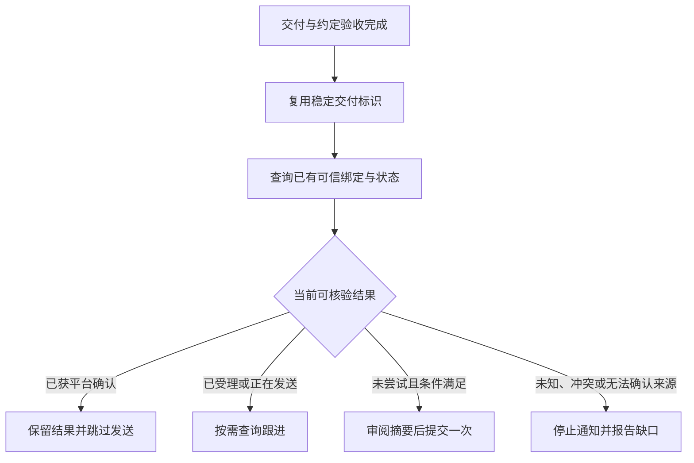

# 08.交付与回执：把结果带回原反馈者

> 文档状态：Review
>
> 责任角色：Director
>
> 本文负责：解释可信来源关联、交付记录、默认通知路径和消息结果

## 1.让结果回到最初提出问题的人

开发者通常能看到PR和部署记录，原群用户却不一定知道它们。因此，交付流程还需要回答：该把什么结论，送回哪个可信来源，怎样知道发送结果？

HiveFlow用真实来源关联把准确仓库和Issue绑定到原反馈来源，再用稳定的交付标识核对同一次结果。公开摘要只包含适合该群的必要结论。

这项安排分别保存业务完成和通知状态。合并、部署、验收、消息受理、平台确认与用户已读，各自有自己的证据。

## 2.可信来源关联为什么要提前做

新Issue创建成功并读回后，群入口应在原请求仍有效时及时建立长期来源关联，核验真实桥接的确认。不能等跨天交付完成才回头猜原来的群。

这份关联由桥接私有状态维护，指向唯一原来源。它不会因为另一个群也讨论同题，就允许转发那边的内容或把结果改投过去。

如果关联建立失败，事项仍然可能已经登记。此时照实给登记答复，并说明长期来源未确认；不能因为工单有链接就承诺以后一定可以回群。

## 3.交付主记录保存什么

Issue是统一交付事实的主记录，关联PR沿用同一稳定`deliveryId`。这个字段用于识别同一次交付，不因超时、恢复或重试另造一个编号。

|记录内容|用来核验什么|
|---|---|
|准确仓库、Issue与关联PR|结果属于哪一件事|
|提交与检查证据|实际候选是否经过必要检查|
|环境交付及其证据|部署了什么，或为何本次不需要部署|
|验收|约定目标是否满足|
|允许公开的摘要|哪些真实结论适合原反馈受众|

离线校验器可以判断结构，无法证明记录里的测试、作者、部署和验收真实。消费者仍要交叉核对真实工具返回的事实，并重新审阅公开摘要。

只有PR待审时，不写最终完成记录。没有PR的任务也不能伪造一个PR，而要在可信本人通道核验实际完成范围，再按已有规则处理。

## 4.当前默认怎样通知

新交付默认在原任务范围内，通过既有HTTP回执入口查询可信来源和发送状态，最终条件满足后将必要脱敏摘要回原群。调用方不指定任意收件群，也不从Issue正文取得网络配置。

无有效绑定时，已经完成的交付正常结束并注明通知未发。无法区分缺绑定还是准入失败时，写“未能确认”，不能把未知说成确实没有。

## 5.为什么同一交付只选一条路径

既有交付可能已经选择PR完成评论唤醒dots，由dots核验后通知原群。这条路径与新的默认HTTP路径要避免重复使用。

|本次已有事实|应怎样继续|
|---|---|
|新交付选择默认HTTP|沿原任务直接查询和通知，不再另造PR唤醒标记|
|原先已选PR→dots|保留原路径，核对真实处理状态|
|任何路径已受理、已发送或状态未知|先查同一次交付，不从另一条路径接手重发|

共享交付标识和去重记录有助于核对，但不能阻止所有参与者同时操作，也不能保证外部动作恰好执行一次。参与者仍须遵守发送前核验和未知停止规则。

## 6.怎样理解几个发送状态

`accepted`表示服务已经持久接收或识别了同一交付；`pending`或`sending`表示已受理后等待或处理中；`wecom_ack`表示企微平台确认；它们都不能证明用户已读。

`not_found`只表示该交付标识无记录。只有确认从未尝试、没有未知操作，而且最终条件满足时，才可能提交一次；不能换新标识得到not_found后绕过原未知结果。

`unknown`、冲突、超时或拒绝都要求先核验。改正文、换群、换路径或换标识，不会使原来的不确定消失。

## 7.公开摘要怎样写

摘要回答三个问题：什么问题已经得到怎样的处理，依据是什么，使用者还需要知道什么限制。

合成示例：

> 关于导出只到第一页的问题，约定环境中的修复已完成，按原操作验收已包含筛选范围内的全部结果。尚未验证的其他使用场景没有计入本次通过范围。

实际表述必须来自真实证据。私有源码、内部地址、群身份、凭据、原始日志和私人评审正文不随摘要发出，Issue里已经写过也不等于可原样转发。

## 8.通知未确认时怎样结束

最终报告可以说明“业务交付完成，原群回执未确认”，并列具体缺口。这不会触发重新开发、撤销已完成结果或擅改事项状态。

在允许的本人通道可提供一份适合转发的脱敏摘要，由本人自行决定是否手工发送。提供摘要、本人确认已转发、桥接确认和用户已读分别记录，不把其中一项冒充另一项。

后续仅补正式记录或关单时，已经确认的原回执不再重发。需要真实通知验证时也不重复已完成事项，不为凑成功制造新的测试工单或补绑历史来源。

## 本章依据

- [HFL-006：来源关联、交付记录与单一路径](../../06-自动化/HFL-006-研发交付与原群回执.md)
- [HFL-007：来源与发送状态查询](../../06-自动化/HFL-007-HTTP回执接口.md)
- [HFL-019：已有通知验证范围](../../06-自动化/HFL-019-接入与验收记录.md)

[返回目录](README.md)｜[上一篇：手动研发：选择PR待审或完整交付](07-手动研发：选择PR待审或完整交付.md)｜[下一篇：原生自动化：先配置范围，再选择新事项](09-原生自动化：先配置范围，再选择新事项.md)
