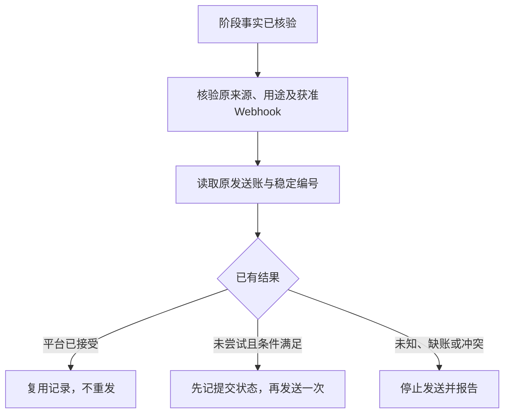

# 08.交付与回执：把结果带回原反馈者

> 文档状态：Review
>
> 责任角色：Director
>
> 本文负责：解释可信来源关联、交付记录、默认通知路径和消息结果

## 1.让结果回到最初提出问题的人

开发者通常能看到PR和部署记录，原群用户却不一定知道它们。因此，交付流程还需要回答：该把什么结论，送回哪个可信来源，怎样知道发送结果？

当前[统一回执分工](../../06-自动化/HFL-006-研发交付与原群回执.md#即时答疑与正式回执)要求Hermes和Codex都通过准确原群的获准Webhook发送PR待审、交付及正式受阻状态，并按[文本回执与成员提醒](../../06-自动化/HFL-007-HTTP回执接口.md#文本回执与成员提醒)提醒本单提出人。普通咨询仍由QueenBee直接答复；同一结果不在两个通道重复播报。缺获准路由时向当前可信执行会话报告，不借用发布群，不因补提醒重发已接受或结果未知的回执，也不要求用户反复发消息维持临时回复窗口。

HiveFlow用真实来源关联把准确仓库和Issue绑定到原反馈来源，再用稳定的交付标识核对同一次结果。公开摘要只包含适合该群的必要结论。

这项安排分别保存业务完成和通知状态。合并、部署、验收、消息受理、平台确认与用户已读，各自有自己的证据。

## 2.可信来源关联为什么要提前做

新Issue创建成功并读回后，Hermes在受控私有记录中保存真实企微来源、准确Issue、登记结果与通知用途。不能等跨天交付完成才回头猜原来的群；来源保存不等于已经具备通知能力。

这份关联指向唯一原来源，正式通知另核验该项目、原群与用途的获准Webhook。另一群也讨论同题，不允许转发其私有内容或把本单结果改投过去。

如果关联建立失败，事项仍然可能已经登记。此时照实给登记答复，并说明长期来源未确认；不能因为工单有链接就承诺以后一定可以回群。

## 3.交付主记录保存什么

Issue是统一交付事实的主记录，关联PR沿用同一稳定`deliveryId`。这个字段用于识别同一次交付，不因超时、恢复或重试另造一个编号。

|记录内容|用来核验什么|
|---|---|
|准确仓库、Issue与关联PR|结果属于哪一件事|
|提交与检查证据|实际候选是否经过必要检查|
|环境交付及其证据|部署了什么，或为何本次不需要部署|
|验收|约定目标是否满足|
|允许公开的摘要|哪些真实结论适合原反馈受众|

离线校验器可以判断结构，无法证明记录里的测试、作者、部署和验收真实。消费者仍要交叉核对真实工具返回的事实，并重新审阅公开摘要。

PR模式也要发原群阶段回执，说明“PR已提交、待审阅”，不写最终完成记录。阶段与后续完整交付各有稳定标识，分别保存在原Issue中，不覆盖或借新标识绕过未知通知。没有PR的任务也不能伪造一个PR，而要在可信本人通道核验实际完成范围，再按已有规则处理。

## 4.当前默认怎样通知

新任务通过准确原群的获准Webhook发送正式事项回执。发送前核对来源、用途、提出人、稳定deliveryId、受众及完整请求摘要，再检查原机器的私有发送账。正文使用真实段落换行；只提醒本单已核验提出人，不提醒所有人。

没有原群路由时在可信执行会话说明缺口，不借用发布群。Webhook不依赖临时回复上下文，也没有服务端状态查询；本地status只读已保存结果，不证明平台刚刚重新确认。执行者缺持久记录或对应工具能力时，保留阶段未完成，不能用一次裸发送冒充受控通知。

已完成的研发事实保留；通知缺口不要求重新开发。

### 不必每次重新找人和写脚本

高频通知应先配好项目、准确群、既有Webhook、获准成员目录和通知账。之后使用`wecom_notify.py`的`plan`预览最终正文、`send`提交一次、`status`查原结果；要提醒谁就传该人的准确姓名，工具使用企微真实提醒字段，不在正文拼“@姓名”。同名或未知身份仍会停下，不能猜测。

工具只缓存实际需要的成员，按群和目录来源隔离，默认24小时；缓存命中后，读取正文和本地账即可，不再遍历各个仓库、凭据或历史聊天。成员目录变动时刷新缓存，已有原通知账继续复用，不能换编号重发未知结果。正文审核后可固定完整请求摘要，避免使用旧稿或带回已删内容。

具体命令与配置在[快捷通知入口](../../06-自动化/HFL-007-HTTP回执接口.md#快捷通知脚本)维护。业务仓库中的发送能力仍受当次授权限制；公开参考副本只保留离线预览、查账及合成验证，不向真实群发消息。通知已获授权时先完成通知，必要的文档和代码收尾另记，不让它们拖延用户收件。

## 5.为什么同一交付只选一条路径

同阶段只有一个发送方和一个稳定编号。Hermes与Codex核对同一事实，不能一方直接答复、一方再用Webhook播报相同结果。换机器前读取原机器的通知账；缺账或结果未知时不发送。

旧Dots、Slack和bridge记录只用于核实历史。不能恢复旧连接、生成PR唤醒标记，或把旧未知通知改走Webhook重发。旧schema与dots前缀可保留，它们不是现行平台名称或启用指令。

执行占用和本地去重约束遵守协议的执行者，不是跨设备硬锁，也不承诺外部动作恰好一次。

## 6.怎样理解几个发送状态

`wecom_ack`表示企微返回成功接受；`rejected`表示明确拒绝；`unknown`表示超时、断线、崩溃或无法确定结果。平台接受、群内实际出现、提出人收到提醒与用户已读分别记录。未知和拒绝都不能自动重试。

提交网络请求前先持久保存unknown，连同稳定编号、受众和请求摘要；只有真实响应才更新结果。缺少本地记录不证明从未发送，不能换新标识或换机器绕过旧未知结果。首次发送还须确认本阶段确实未尝试。

旧bridge的accepted、pending、sending和服务端not_found仅供历史查证，Webhook没有这些服务端查询能力。

## 7.公开摘要怎样写

摘要先说实际结果，再说有证据的原因、用户影响和下一步，按本次情况自然简写，不要求固定模板。影响用户判断的重要失败、未验证范围和使用限制仍要说明，不反复附加“不会把它标为成功”等自我保证。

开头还要写清是在回复谁：使用本单已核验的提出人姓名和问题名称，例如“示例提出人，你反馈的‘示例问题’已在开发环境处理……”。只称呼同一原群的当前提出人；不知道姓名时写问题和编号，不猜名字，也不因缺姓名停住交付。普通文字称呼不是实际@提醒，已经发过的旧回执不为补称呼重发。

合成示例：

> 导出范围已修复，现在能一次导出筛选结果，跨页验收通过。原先只取得当前页，是导出请求沿用了分页参数。你可以按原步骤使用。

失败时同样说明真实情况。例如，已核实镜像拉取被拒且旧版本仍在运行，可以说明新版本尚未切换、现有服务仍可用，以及下一步核对拉取配置；若只知道页面验收卡在登录跳转，就说明缺少哪次请求的证据和下一步，不猜原因或让用户空等。示例中的原因和可用性必须分别有依据。

实际表述必须来自真实证据。私有源码、内部地址、群身份、凭据、原始日志和私人评审正文不随摘要发出，Issue里已经写过也不等于可原样转发。

## 8.通知未确认时怎样结束

最终报告可以说明“业务交付完成，原群回执未确认”，并列具体缺口。这不会触发重新开发、撤销已完成结果或擅改事项状态。

在允许的本人通道可提供一份适合转发的脱敏摘要，由本人自行决定是否手工发送。提供摘要、本人确认已转发、平台确认和用户已读分别记录，不把其中一项冒充另一项。

后续仅补正式记录或关单时，已经确认的原回执不再重发。需要真实通知验证时也不重复已完成事项，不为凑成功制造新的测试工单或补绑历史来源。

## 9.发布前后为什么另发公告

正式开发发布还需要让已批准的固定受众知道“即将发版”和“发版完毕”。发布入口直接调用固定HTTPS Webhook发送公告；群由受控配置固定，调用者不能指定任意群，也不用历史Issue充当通知通道。

有变化的正式发布，只在北京时间周一至周五08:00至18:00前提交群通知，各阶段分别判断。时段内先发开始消息，得到企微确认后才执行；时段外记录跳过，照常发布，不等候或补发。部署检查通过后处理完成通知；若本次还要求页面验收，就在验收后用原发布记录收尾，并重新判断时间，不再次部署。计划查询、迁移试跑和无变化不通知。部署失败时说明具体阶段、已知原因、用户影响和下一步；原因未知则明确当前卡点，失败通知也受时间限制；已提交但结果未知时仍只查询原记录，不因跨时段改记为跳过。

只有工作台或管理台前端页面更新时，公告说明可以继续工作，完成后刷新浏览器即可；不要求暂停新会话。包含后端、运行环境或数据库时，再按实际影响说明需要配合什么。

自动公告也要交代当次事实。例如，因仍有任务运行而停止发布，就说明这个原因以及等待任务自然结束后再检查重试条件；不能只说“未完成，请等待”。发布入口先读取本次失败记录，再提炼对群有用的信息；记录缺失就说清待核对的依据。模板只是提示，不应成为省略原因的理由。

公告只说明本次发布阶段，Issue回执仍负责本单结果。已成功部署但通知未知时，两项事实分别保留；平台确认仍不等于用户已读。准确群路由、地址和运行证据留在私有配置，不能随介绍公开。具体边界由[HFL-007](../../06-自动化/HFL-007-HTTP回执接口.md#当前发布操作与恢复)负责。

## 本章依据

- [HFL-006：来源关联、交付记录与单一路径](../../06-自动化/HFL-006-研发交付与原群回执.md)
- [HFL-007：来源与发送状态查询](../../06-自动化/HFL-007-HTTP回执接口.md)
- [HFL-019：已有通知验证范围](../../06-自动化/HFL-019-接入与验收记录.md)

[返回目录](README.md)｜[上一篇：手动研发：选择PR待审或完整交付](07-手动研发：选择PR待审或完整交付.md)｜[下一篇：原生自动化：先配置范围，再选择新事项](09-原生自动化：先配置范围，再选择新事项.md)
