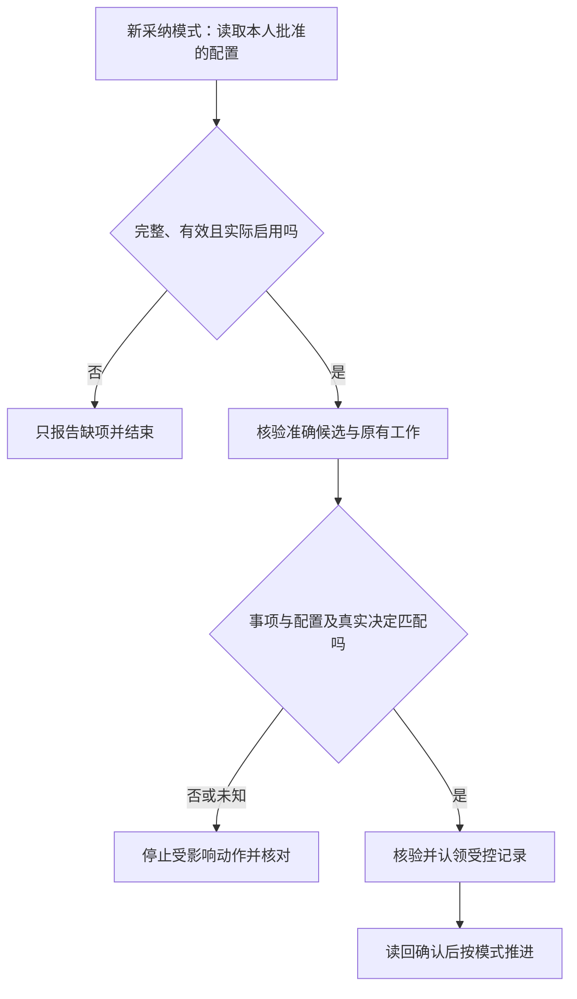

# 09.原生自动化：先配置范围，再选择新事项

> 文档状态：Review
>
> 责任角色：Director
>
> 本文负责：解释定时任务配置、选单规则和自动执行启用前的准备

## 1.从人工协调走向有范围的自动承接

负责人手动处理每次反馈，可以看清过程，但也会反复完成找事项、转述方案和追问进度。HiveFlow的探索方向，是把已经说明白且能够验证的衔接，逐步交给现成自动化能力。

自动化前先固定目标、范围和停止条件。一个工具能按时运行，不表示它有权自行挑选任何需求；一项需求被采纳，也不表示所有研发和环境动作都已获准。

本项目选择MacMini上Codex桌面自带的原生Automations，复用本地项目、工作树和原有任务记录。定时运行发生在本机；云端dots提供的采纳记录只是受控决定的交接，不承担本地研发调度。具体支持的选项及实际保存结果以当前宿主核验为准，本书不另行定义调度服务。

## 2.定时启动也有两种交付终点

|任务模式|范围内执行的终点|Director何时再介入|
|---|---|---|
|PR待审|开发、测试、提交推送和创建PR|PR完成后再介入1次，决定并推进合并、部署|
|完整交付|研发、所需审阅修正、合并、指定环境交付、验收和正式收尾|有效完整授权内不逐单增加例行确认，接收真实结果|

定时替代的是Director每次在MacMini手动发起任务，不改变交付终点。定时生成的PR仍会等待本人；完整交付仍要真实完成规定审阅与验收。PR后本人可以亲自操作，也可以在可信本地会话明确授权继续。

配置批准和实际启用不能省略；选择新采纳模式时，每单的真实采纳也不能省略。这里的“无需逐单手动发起”只适用于仍在有效窗口、范围和数量内的事项；约定本人验收或出现超出授权的问题时，仍按实际情况介入。四种组合的次数对照见[第3章](03-流程总览：一条反馈怎样走到交付.md#9director需要介入几次)。

两类任务共享授权、去重、停止和恢复要求。暂停模板可以先准备，不能把任务已经保存、名字写着“完整交付”，或者界面能手动运行，当作执行许可。

当前业务自动开发尚未启用。下面说明启用前怎样准备，以及将来在有效配置中怎样执行；不是要求现在运行这些任务。

## 3.一份可执行配置需要哪些内容

可以先用普通语言把配置理解成一份有界任务约定：

|配置方面|为什么必须明确|
|---|---|
|仓库和本地项目|防止对同名目录或错误代码库执行|
|模式和终点|明确停在待审，还是完成约定交付|
|事项清单或选单规则|知道允许处理哪一件事，不能由正文临时扩展|
|目标、验收和风险|让工具能判断该做什么、哪些变化需停止|
|时间窗口、时区和总数量|防止长期沿用一次许可，或一次处理过多事项|
|环境、评审和恢复条件|完整交付真正具备所需能力|
|执行开关和实际启用状态|同时满足授权与平台配置要求|
|停止、撤销和已有占用|避免在任务已经不适用时继续修改或外部操作|

模板缺少具体事项、期限或环境时，保留暂停状态用于准备。误改为运行状态也不能补足这些空缺。

## 4.明确清单与新采纳选单有什么区别

明确清单表示负责人已经批准执行准确列出的事项。工具仍需核验范围和已有工作，不因为列在清单里就重做已完成任务。

新采纳选单表示：只有有效配置启用后新增的真实采纳，且同时命中仓库、事项、范围、窗口、数量和风险条件，才可以进入候选。其可信决定由受控采纳记录衔接，不能凭Issue标签或正文认定。

图中认领用于选择新采纳的受控流程；明确清单不能作为采纳来源读取失败后的自动替代方案。

## 5.首次试验为什么只选一单

首次真实自动试验限定一个启用后新增的事项，并明确`maxIssues=1`。这样可以在较小范围核对决定、认领、执行、撤销和通知，而不是先把历史已采纳清单全部交给工具。

只有能核验实际数量和跨运行进度时才继续。读到同一事项已有活跃任务、PR或未知结果，应先复用或核实；不能换一个任务重新执行。

首次试验限制是现行规范中的准备边界，不代表已经做过真实单事项试验，也不代表之后可以自动改成无限循环。

## 6.按频率检查不等于即时唤醒

原生任务按获准频率运行并发现候选，不承诺dots每次采纳都会立刻启动开发。选单来源、实际运行状态和平台能力都需要分别核验。

不为了追求即时性增加另一套调度器、Issue触发开发的入口或平行队列。既有群反馈和交付回执监听也不会因为自动化方案存在，就取得开发权限。

工作树隔离保护文件，普通记录帮助判断占用；它们不能单独提供跨参与者的全局互斥。运行中暂停的真实效果也需要实测，不能把按钮状态写成硬中断保证。

## 7.一轮运行中持续核对什么

每次新的修改、提交、部署或外部操作前，都复查配置有效性、当前任务状态、停止请求、本人认领和已发生结果。到期或取消后，不再推进未获准阶段。

遇到失败或未知，先查原运行和实际发生的变化，未厘清前停止本配置取新事项。实际结果留在原任务和受控记录中，不通过换任务、换标识或按超时释放占用重做。

运行结束时，PR待审只表示到达审阅终点；完整交付才按真实审阅、部署、验收和正式记录判断结束。通知缺口另行报告，不能靠重复研发解决通知问题。

## 8.网站怎样介绍这项方向

可以介绍“在负责人预先批准的范围内，由新采纳事项衔接后续执行”的设计，并同时注明业务自动开发尚未启用。

暂停模板、原生任务保存成功、单槽初始化、离线校验和真实研发试验是不同阶段。网站展示应明确对应哪一阶段，不能用一张连续箭头图把它们都画成已完成的线上能力。

## 本章依据

- [HFL-009：配置、选单与原生模板](../../06-自动化/HFL-009-原生自动化任务模板.md)
- [HFL-003：预授权配置与交付终点](../../06-自动化/HFL-003-协作流程与授权.md)
- [HFL-010：新采纳记录衔接](../../06-自动化/HFL-010-采纳记录与任务认领.md)

[返回目录](README.md)｜[上一篇：交付与回执：把结果带回原反馈者](08-交付与回执：把结果带回原反馈者.md)｜[下一篇：采纳交接：记录、认领、撤销和恢复](10-采纳交接：记录、认领、撤销和恢复.md)
